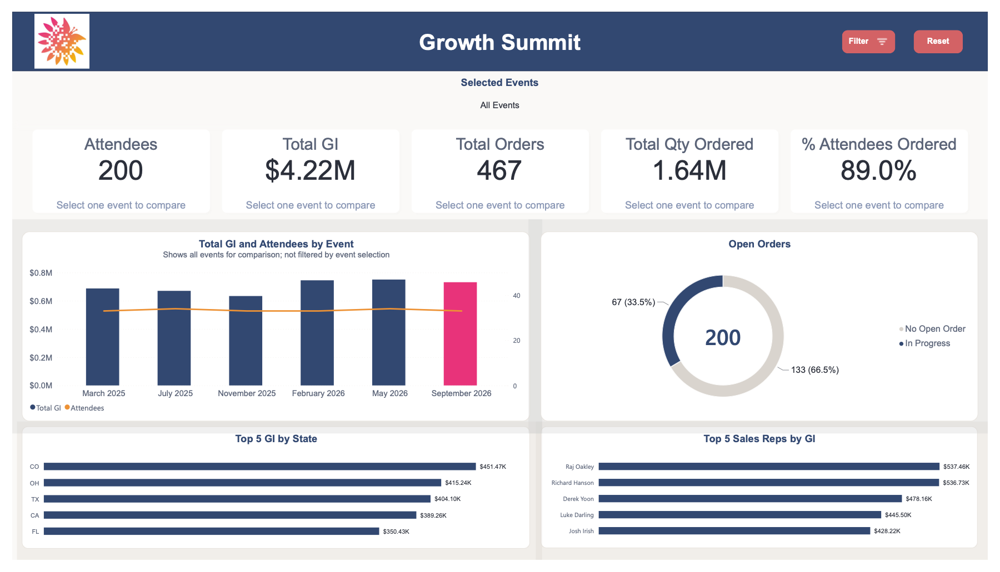
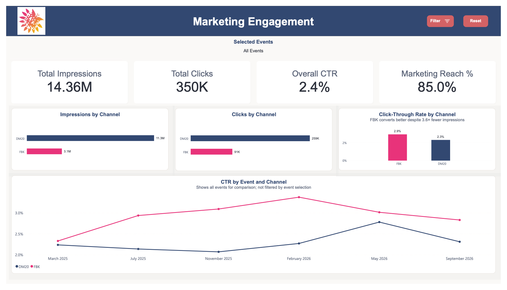
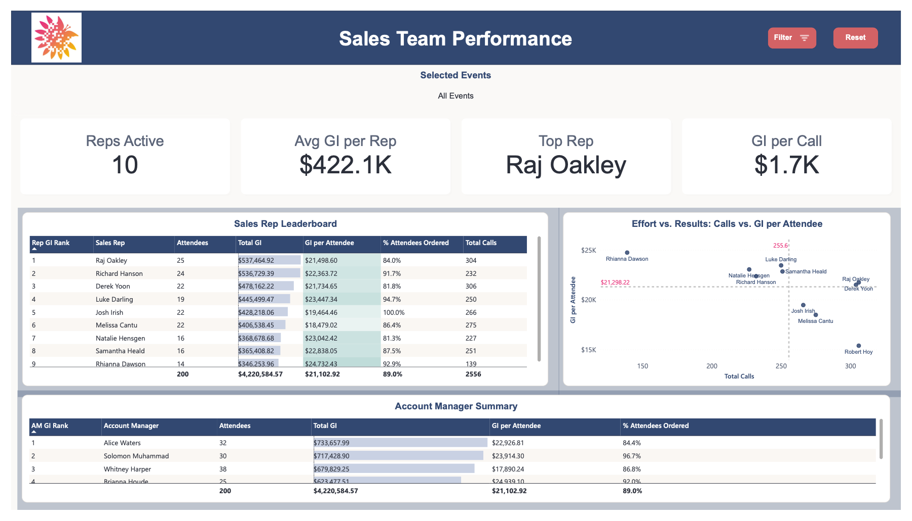

# Growth Summit Attendee Report (Power BI)

A multi-event Power BI report that turns a single flat attendee table into an interactive report covering attendance, revenue, marketing and sales-team performance across six Growth Summit events.

I built it from a business requirements brief using sample data. The brief asked for a report that could filter by event, go beyond a flat table, and later be repointed from Excel to a live SQL database with minimal rework.

**Tools:** Power BI Desktop, Power Query (M), DAX, star-schema data modeling



---

## What it does

| Page | Purpose |
|---|---|
| **Overview** | KPI cards (attendees, total GI, orders, quantity ordered, % of attendees who ordered). When one event is selected, each card shows the change vs. the prior event, colored green/red. Includes a trend chart of every event, open orders, and the top 5 states and sales reps. |
| **Attendee Detail** | Record-level drill-through target. Reached from any state, sales rep, order status or event, with a subtitle that shows what you drilled from and data bars on GI. |
| **Marketing** | DM20 vs. Facebook comparison: impressions, clicks, click-through rate, and CTR trend by event. |
| **Sales Team** | Rep leaderboard ranked by total GI, with GI per attendee alongside it. A calls-vs-GI scatter with average lines splits reps into quadrants by efficiency. |
| **Data Dictionary** (hidden) | Built from the model's own metadata, so it stays current: every measure with its definition, plus columns, tables and relationships. |

The event slicer is synced across every page and supports one, several or all events, with a reset button. Every page also has a mobile layout.

| Marketing Engagement | Sales Team Performance |
|---|---|
|  |  |

## Key findings in the sample data

- DM20 drives about **3.6× more impressions** than Facebook, but Facebook has the **higher click-through rate** (≈2.9% vs. 2.3%).
- The top rep by total GI isn't the top rep by **GI per attendee**, which the flat table hid.
- May 2026 attendance was up 3% from the prior event, and GI was up 0.7%.

## Data model

**Star schema:** one fact table at the grain of *one row per account per event*, with Event, Account, Sales Rep and Account Manager dimensions. All relationships are one-to-many and single-direction. The sample has each account at one event, but the grain supports repeat attendees once live data comes in.

- **Single staging query:** `stage_growth_summit` loads the source once and isn't loaded to the model. Every dimension and the fact table reference it.
- **Parameterized source:** the Source step reads a `SourceFilePath` parameter instead of a hard-coded path. I tested this by repointing to a copy in another folder and refreshing.
- **Derived event date:** the source has only a text label (e.g. "May 2026 Growth Summit"), so I parse a date from it. That keeps slicers and trend charts in date order instead of alphabetical.
- **Disconnected Channel table:** drives the DM20 vs. Facebook side-by-side visuals through a `SWITCH` measure.
- **Measures table:** 50 measures organized into display folders (Base, Ratios, Marketing, Conversion, Event Comparison, KPI Labels, Display, Rankings, Sales). Full list: [`docs/Measure_Descriptions.csv`](docs/Measure_Descriptions.csv).

### Swapping to SQL Server

Add `ServerName` and `DatabaseName` parameters and replace the Source and Navigation steps with:

```m
Source = Sql.Database(ServerName, DatabaseName){[Schema="dbo", Item="vw_GrowthSummitAttendees"]}[Data]
```

If the view returns the same column names as the spreadsheet, nothing downstream changes.

## DAX highlights

- **Prior-event comparison:** `Prev Event GI` finds the event immediately before the current one by Event Date. `GI vs Prev Event %` returns a value only when a single event is in context.
- **Dynamic KPI labels and colors:** each card's reference label shows an arrow and % change, and a companion measure returns a hex color used through conditional formatting.
- **Context-aware text:** `Selected Events Label` shows "All Events", up to two event names in date order, or "N Events Selected". `Detail Context` adds any drill-through filters.
- **Rankings:** dense rank of reps and account managers by GI within the current selection.

## Assumptions

- **Total GI** appears to be a lifetime figure per account, not revenue from the event, and is labeled that way.
- The **event date** is derived from the event name.

## Repo contents

```
report/GrowthSummitReport.pbix        Power BI report
report/GrowthSummit_Theme_Arial.json  Custom report theme
data/GrowthSummit_TestData.xlsx       Sample dataset (synthetic, no real people or companies)
docs/Measure_Descriptions.csv         All DAX measures with descriptions
screenshots/                          Report page images
```

To open the report, install [Power BI Desktop](https://www.microsoft.com/power-bi/desktop) (Windows). Then open the `.pbix` and set the `SourceFilePath` parameter (Home → Transform data → Manage Parameters) to the location of `data/GrowthSummit_TestData.xlsx`.
